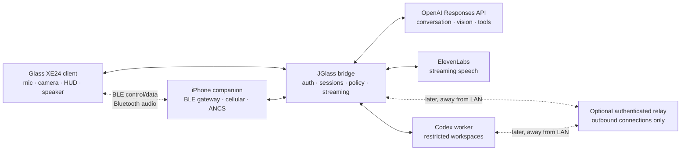

# Proposed architecture

## Direction

JGlass uses Google Glass as a thin, purpose-built edge client. A modern bridge owns expensive computation, credentials, provider APIs, session state, and safety policy. A separately authorized Codex worker owns computer-side actions.



## Components

### Glass client

Responsibilities:

- native launch/voice-trigger and touchpad interaction;
- microphone capture with clear recording state;
- intentional one-shot camera capture;
- small, readable streaming response cards;
- audio playback and interruption;
- authenticated connection to the bridge;
- no long-lived provider credentials.

At application launch, Glass runs a once-per-local-calendar-day startup state
machine before exposing the ordinary ready card. It animates locally, sends a
bounded authenticated Wi-Fi request, validates the complete response before
writing audio, displays Open-Meteo attribution with dynamic weather, and deletes
dynamic MP3 data after playback. Only three fixed period-specific offline clips,
their version, the revocable bridge configuration, and last playback date are
retained in app-private storage. A debug-only launch extra can force replay.

Constraints:

- Android 4.4.4 / API 19 on the verified XE24 unit, with old TLS/runtime behavior;
- 640x360 display;
- limited memory, battery, CPU, and thermal headroom;
- discontinued Google services;
- physical-device testing is mandatory for meaningful UX claims.

### Bridge service

Responsibilities:

- device authentication and session state;
- protocol version negotiation;
- speech-to-text and interruption control;
- OpenAI request orchestration and intentional image submission;
- ElevenLabs streaming speech;
- compact response formatting for the HUD;
- action proposal and approval state machine;
- privacy-aware logging with payload redaction.

The bridge should expose a typed protocol but not expose provider APIs directly to Glass.

The first implemented bridge slice is Node 22+ TypeScript using built-in HTTP
and `fetch`, with no runtime dependencies. It binds to loopback by default and
implements authenticated `jglass/startup/1` for configured-location Open-Meteo
weather and ElevenLabs `mp3_22050_32` speech. Trusted-LAN binding is explicit;
the service is not a public endpoint. Coordinates, device/provider secrets,
voice IDs, spoken text, and audio are omitted from normal logs.

### Codex worker

The Codex worker is not a general remote shell. It accepts bounded requests from the bridge, operates only in configured repositories, and returns structured status.

Minimum states:

```text
requested -> planned -> awaiting_approval -> running -> completed
                                  |             |
                                  v             v
                               rejected       failed
```

Read-only questions may be eligible for a lower-friction path. File edits, package installation, commits, pushes, messages, destructive operations, or access outside approved roots require explicit policy and, where appropriate, user confirmation.

### iPhone integration

Two different mechanisms must not be conflated:

1. Glass as an ANCS BLE client can request notification metadata and advertised actions from iOS.
2. A project-owned iPhone companion can exchange JGlass-owned data and invoke APIs for which it has permission.

The iPhone companion is also the selected mobile gateway. Glass remains the BLE
central; the iPhone publishes a project-specific peripheral service and relays
only authenticated JGlass traffic over its normal cellular or Wi-Fi connection.
This is application proxying, not Personal Hotspot or general IP tethering.

Physical XE24/iPhone testing found asymmetric audio behavior: iOS offers Glass
as a call-audio device, but ordinary iPhone media does not route to Glass and
the Glass diagnostic reports no A2DP media connection. A companion-owned
play-and-record spike could select Glass as HFP input and output but received no
input buffers. Actively rendering output caused iOS to fall back to the phone's
built-in microphone and receiver. HFP therefore remains available for ordinary
calls but is not the JGlass application transport. BLE carries control,
response text, progress, approvals, and bounded compressed audio in both
directions.

Foreground physical testing also verifies the selected GATT roles and control
framing: Glass connected as the central, discovered both control
characteristics, subscribed to the downlink, and completed fragmented
hello/acknowledgement and ping/pong exchanges with the iPhone peripheral.

The feasibility diagnostic now separates maintained-connection wake from
rediscovery/reconnection. Its connected mode sends five delayed pings on one
subscribed GATT link; its reconnect mode performs five bounded close, wait,
rediscover, reconnect, subscribe, and ping cycles after the baseline exchange.
Only ephemeral counts, relative timing, and stable failure categories are shown.
On the physical pair, all five delayed writes completed while the established
connection remained locked in the background. Rediscovery did not: five cycles
after a foreground exchange and all six cycles begun while ordinarily
backgrounded ended `not_found`. The current gateway direction is therefore
viable only while its GATT connection survives; reliable recovery after a drop
remains an architecture blocker to resolve before depending on mobile access.

An iPhone companion cannot become a universal notification reader. Service-specific replies may require app intents, shortcuts, deep links, or service APIs and should be designed separately.

## Initial protocol sketch

Use a versioned envelope and explicit message types. The final encoding is undecided.

```json
{
  "protocol": "jglass/1",
  "type": "assistant.request",
  "sessionId": "opaque-id",
  "requestId": "opaque-id",
  "timestamp": "RFC-3339",
  "payload": {}
}
```

Likely event families:

- `session.open`, `session.close`
- `audio.start`, `audio.chunk`, `audio.stop`
- `transcript.partial`, `transcript.final`
- `vision.snapshot`
- `assistant.text.delta`, `assistant.text.final`
- `assistant.audio.chunk`, `assistant.audio.stop`
- `action.proposed`, `action.approved`, `action.rejected`
- `action.progress`, `action.completed`, `action.failed`
- `error`

Every request and side effect needs an ID so reconnects do not accidentally repeat actions.

## Security and privacy

- Bind the first prototype to loopback or a trusted LAN only.
- Require a per-device token even on the LAN once the basic transport works.
- Never expose a development server directly to the public internet.
- Prefer a relay where both bridge/worker connections are outbound and authenticated.
- Redact authorization headers, transcripts, image payloads, notification bodies, file contents, and model context from normal logs.
- Make retention opt-in; default to ephemeral audio and images.
- Display a visible recording/camera state.
- Treat model output as untrusted input to action tools.
- Keep conversational tools and computer mutation tools in separate allowlists.

## Key trade-offs

### Stock XE24 versus AOSP 5.1.1

Stock XE24 preserves the native Glass UX and GDK integration but is constrained and old. AOSP 5.1.1 offers a more conventional rooted Android environment and supports some recent community work, but sacrifices parts of the original experience and remains obsolete. Stay on XE24 until a documented blocker justifies switching.

### Push-to-talk versus wake word

Push-to-talk is less magical but drastically easier to debug and kinder to battery. Prove audio quality, latency, cancellation, and reconnection before adding an always-listening detector.

### Snapshot versus continuous vision

One-shot camera capture is predictable, private, and inexpensive. Continuous streaming adds heat, bandwidth, privacy, and inference-cost problems. Continuous vision is out of scope for the first milestones.

## Decision records

Architecture-changing choices belong in `docs/adr/`. The startup bridge and
reversible XE24 system branding are recorded in ADRs 0004 and 0005.
